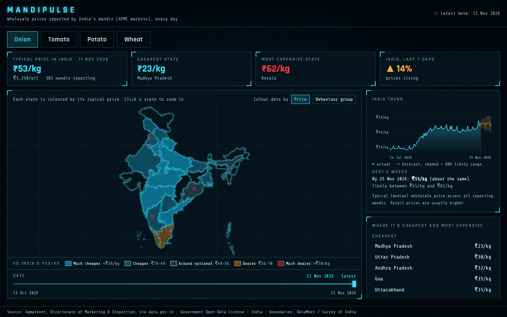
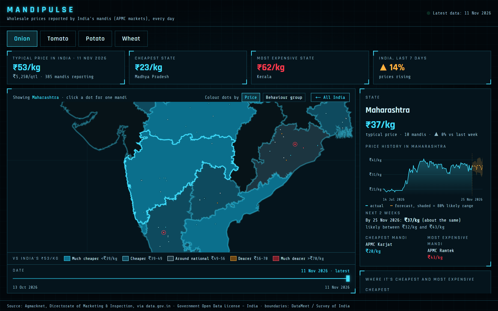
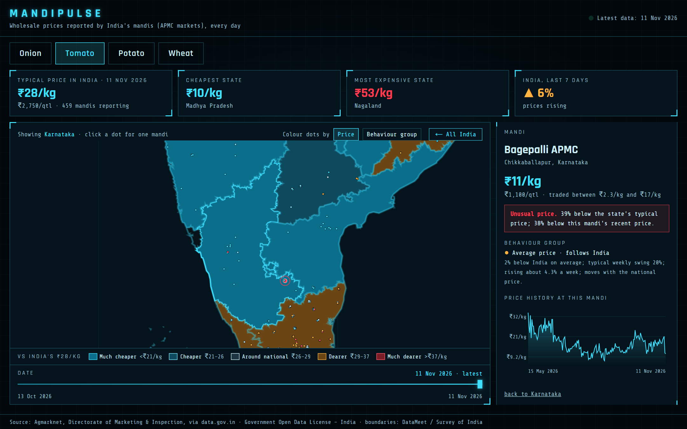
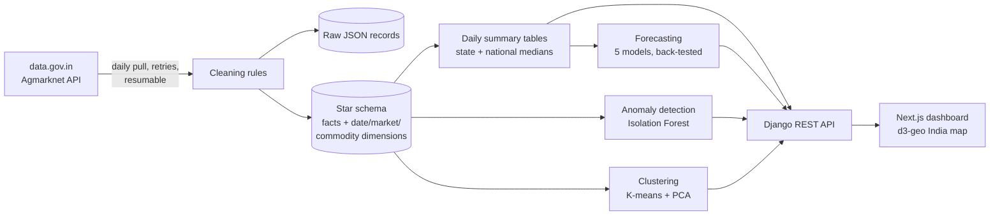

# MandiPulse

**Live wholesale commodity prices from India's mandis on an interactive map, with 14-day price forecasts, unusual-price detection and market segmentation.**

Built on real government open data (Agmarknet, via data.gov.in), not a toy dataset: roughly a million daily price reports from 3,000+ mandis in 30 states.

**Live demo: [akshat-shah04.github.io/MandiPulse](https://akshat-shah04.github.io/MandiPulse/)** (a static snapshot of the last 30 days; no install needed)



---

## What it does

- **Map:** each state is coloured by how its typical price compares with the national price (much cheaper → much dearer). Every mandi is a dot. Click a state to zoom in, or a mandi to see its own history.
- **Forecast:** the next 14 days for India and for each state, with an 80% likely range, from the model that tested best for each day ahead.
- **Unusual prices:** an Isolation Forest flags mandis whose price is far from their state *and* from their own recent prices, with a plain-English reason ("39% below the state's typical price").
- **Behaviour groups:** K-means sorts mandis into groups like *"Cheap · volatile · own path"*, shown on a PCA scatter chart and on the map.
- **Time travel:** a date slider replays any past day.

Prices are shown in ₹/kg (what people think in) with ₹/quintal, the trade unit Agmarknet publishes, alongside.

## Screenshots

| Forecast for a state | Unusual price explained |
|---|---|
|  |  |

**Left:** click a state to see its price history and the next 14 days, with the shaded 80% likely range. **Right:** the Isolation Forest flagged Angul (Odisha) at ₹90/kg, 80% above the state's typical price and 2.1× its own recent price, and says so in plain words.

## How it works



1. **Ingest** (`ingest_agmarknet`): pages through the data.gov.in API day by day, backs off when the API returns 502s (it often does), and can be stopped and resumed. Every API row is kept untouched as JSON, so the clean tables can always be rebuilt.
2. **Clean** (`prices/agmarknet.py`): validates every row. See [Data quality](#data-quality-what-the-real-data-taught-me).
3. **Warehouse** (`prices/models.py`): a star schema with `FactPrice` (one row per mandi × variety × day), plus date (including Indian crop season), market and commodity dimensions.
4. **Summaries** (`prices/aggregates.py`): daily median price per state and for India. The API reads these instead of scanning a million rows, which cut response times from 200–700 ms to 4–20 ms.
5. **Models** (`prices/ml/`): forecasting, anomalies, clustering (below).
6. **API + UI**: Django REST Framework serves JSON; a Next.js app draws the map with d3-geo.

## Machine learning

### 1. Price forecasting (14 days ahead)

Five models predict `log(future price / today's price)` for each of the next 14 days:

| Model | Idea | Average error (days 1–14) |
|---|---|---|
| Same as today | price stays the same | **8.0%** |
| LSTM (PyTorch) | reads the last 28 days as a sequence | 8.3% |
| Same weekday last week | weekly pattern | 8.5% |
| Ridge regression | lag and rolling-average features | 8.7% |
| Random forest | same features, 300 trees | 8.7% |

*Back-tested on the last 6 weeks of 83 series (11,281 training / 3,355 test examples), as of Nov 2026.*

**How the test works:** every model trains only on data whose answers fall *before* the test period, then forecasts from each of the last 42 days. Only real mandi reports are graded; gap-filled holiday prices are not. A unit test checks that no training answer reaches the test period.

**The honest result:** the LSTM is the best model for **days 1–5**. On day 1 its error is 5.3% against 5.8% for "same as today", about 10% lower. Beyond a week, nothing beats the simple baselines yet, which is common for commodity prices. So the published forecast uses **the best model for each day ahead**: LSTM for days 1–5, baselines after that. It is never worse than the baseline. The 80% band comes from the chosen model's real test errors.

**A bug worth mentioning:** the first version gave the models the *month* as a feature. The training data covered April–August and the test covered September–November, so the models were asked about months they had never seen. Removing that feature cut the random forest's error by about 20%.

### 2. Unusual-price detection

For each mandi-day: how far is the price from the state's median that day, from this mandi's last 14 reports, and how wide was the day's min–max range? An **Isolation Forest** scores how isolated each point is. A price is flagged only if the forest finds it odd **and** it is at least 50% away from the state or the mandi's own recent price, so every flag means something and gets a readable reason. About 0.3–0.9% of mandi-days are flagged; many look like data-entry slips (wheat at ₹377/quintal), some are genuine local shocks.

### 3. Mandi behaviour groups (market segmentation)

Each mandi gets four numbers from its last 26 weeks: price vs India, weekly swing, 12-week trend, and correlation with the national price. After standardising, **K-means** tries 3–6 groups and keeps the count with the best **silhouette score**. **PCA** reduces the four numbers to two for the scatter chart. Groups are named from their centres, for example for tomato:

| Group | Mandis | Behaviour |
|---|---|---|
| Cheap · own path | 250 | 29% below India, falling ~2%/week, ignores the national price |
| Average price · follows India | 297 | near India, rising ~4%/week, moves with the national price |
| Dear · steady · own path | 231 | 30% above India, smaller swings |

## Syllabus coverage (B.Tech IT, Silver Oak University)

| Course | Topics from the syllabus | Where in this project |
|---|---|---|
| **AI with ML & DL** (Sem 6) | Python toolkits, using APIs, cleaning & munging, rescaling, PCA, linear regression, random forest, train/test splits & overfitting, time series, RNN/LSTM, evaluation | `agmarknet.py`, `ml/examples.py`, `ml/models.py` (ridge, random forest, LSTM), `ml/forecasting.py` (back-test), PCA in `ml/clustering.py` |
| **Advanced Business Analytics & Data Mining** (Sem 6) | Data warehousing, star schema, OLAP roll-up/drill-down, preprocessing (missing/noisy data), K-means, fraud/anomaly detection, market segmentation, time series | `models.py` (star schema), `aggregates.py` (roll-ups), map drill-down from India → state → mandi, `ml/anomalies.py`, `ml/clustering.py` |
| **Big Data Analytics** (Sem 7) | Large datasets, NoSQL/document storage, handling big-data problems | ~1M facts, raw JSON documents kept in `RawRecord`, incremental, resumable daily ingestion with back-off |
| **Web Technology with UI/UX** (Sem 4) | Responsive layouts (flex/grid, media queries), SVG, JS events, UI design | Next.js + Tailwind dashboard, SVG map and charts, delegated event handling |
| **DBMS / Cloud / DevOps** | Schema design, constraints, indexing | unique and check constraints, indexes on (commodity, date), idempotent upserts |

## Data quality: what the real data taught me

Real government data is messy. Rules in `prices/agmarknet.py`, each with a test:

- State names spelled two ways (`Uttrakhand`/`Uttarakhand`, `Keralam`/`Kerala`) are merged so the map joins cleanly.
- Swapped min and max columns are repaired; modal prices outside min–max are clamped.
- Impossible prices are rejected: ₹0.01/quintal at the bottom, and at the top a **tomato price of ₹27 crore/quintal** that crashed the first loader.
- A max price more than 10× the modal (e.g. `30002800`, where "3000" and "2800" ran together) is treated as a typo.
- A mandi reporting several varieties counts once per day, so big mandis don't dominate state medians.
- Mandis are placed at their district's centre with fuzzy name matching (Agmarknet writes "Palakad", the census writes "Palakkad"), handling districts that moved state after 2011 (Telangana, Ladakh).

## Tech stack

**Backend:** Python, Django 6, Django REST Framework, pandas, NumPy, scikit-learn, PyTorch, SQLite (PostgreSQL supported)
**Frontend:** Next.js 16, React 19, TypeScript, Tailwind CSS 4, d3-geo
**Data:** Agmarknet / data.gov.in API, DataMeet boundaries

## Run it locally

You need Python 3.12+, Node 20+, and a free API key from [data.gov.in](https://www.data.gov.in) (My Account → API key).

```bash
# 1. Backend
cd backend
python -m venv .venv && .venv/Scripts/activate        # macOS/Linux: source .venv/bin/activate
pip install torch==2.15.0 --index-url https://download.pytorch.org/whl/cpu
pip install -r requirements.txt
cp .env.example .env                                   # then put your key in DATA_GOV_IN_API_KEY
python manage.py migrate

# 2. Load prices (a year takes a while; it can be stopped and resumed)
python manage.py ingest_agmarknet --newest-first --start 2025-11-01 --end 2026-11-12 \
    --commodity Onion --commodity Tomato --commodity Potato --commodity Wheat
python manage.py geocode_markets

# 3. Train the models
python manage.py train_forecasts
python manage.py detect_anomalies
python manage.py cluster_markets

# 4. Start the API
python manage.py runserver 8000

# 5. Frontend (new terminal)
cd frontend
npm install
npm run dev                                            # http://localhost:3000
```

### Build the hosted demo

The live demo is the same dashboard built as a static site. `export_static` saves what each API URL returns as JSON files, and the frontend reads those instead of calling Django:

```bash
cd backend && python manage.py export_static --days 30 --history-days 180   # writes frontend/public/data
cd ../frontend && NEXT_PUBLIC_STATIC_DATA=1 npm run build                     # static site in out/
```

GitHub Actions (`.github/workflows/pages.yml`) builds and publishes it to GitHub Pages on every push to `main`.

### Management commands

| Command | What it does |
|---|---|
| `ingest_agmarknet` | Pull prices for a date range; resumable; refreshes summaries and map positions |
| `build_aggregates` | Rebuild the daily state/national summary tables |
| `geocode_markets` | Place mandis at their district centre |
| `train_forecasts` | Back-test all models, publish 14-day forecasts |
| `detect_anomalies` | Flag unusual prices |
| `cluster_markets` | Group mandis by behaviour |

### API

`/api/commodities` · `/api/dates` · `/api/map` · `/api/series` · `/api/forecast` · `/api/models` · `/api/groups` · `/api/status`

### Tests

```bash
cd backend && python manage.py test prices
```

31 tests cover the cleaning rules, idempotent loading, the summary tables, the API, train/test leakage, the baseline models, anomaly reasons and clustering features.

## Project structure

```
backend/
  prices/
    agmarknet.py        API client + cleaning rules
    models.py           star schema, summaries, ML outputs
    aggregates.py       daily state/national roll-ups
    geocode.py          mandi -> district centre
    views.py            REST API
    ml/
      series.py         database -> daily price lists
      examples.py       price lists -> training examples + features
      models.py         naive, seasonal naive, ridge, random forest, LSTM
      forecasting.py    back-test, pick best model per day, publish
      anomalies.py      Isolation Forest + plain-English reasons
      clustering.py     behaviour features, K-means, PCA
  scripts/build_geo.py  builds the map layers from DataMeet shapefiles
frontend/
  components/           Dashboard, IndiaMap, TrendChart, Groups, Insights
  lib/api.ts            typed API client, ₹/kg formatting, colour bins
```

## Limitations and next steps

- **History:** about one year so far. A second year would let the models learn seasons (kharif/rabi), the most likely way to beat the baselines beyond a week.
- **Mandi locations** are district centres from 2011 census boundaries, not exact coordinates.
- **SQLite** is fine for one machine; PostgreSQL is supported via environment variables for anything bigger.
- **Next:** Apriori rules on weekly price moves ("when Maharashtra onion rises, Karnataka follows"), weather and arrival-volume features, scheduled daily ingestion.

## Data sources and licences

- **Code:** MIT licence, see [LICENSE](LICENSE).

- **Prices:** Agmarknet, Directorate of Marketing & Inspection, Ministry of Agriculture and Farmers Welfare, via [data.gov.in](https://www.data.gov.in/resource/variety-wise-daily-market-prices-data-commodity), under the Government Open Data License – India.
- **Boundaries:** [DataMeet maps](https://github.com/datameet/maps) (MIT licence), based on Survey of India boundaries. State polygons from `States/Admin2`, district centres from Census-2011 districts.

## Repository history

I wrote the first version locally before this repository existed and pushed it as one initial commit. Changes since then are committed step by step.

---

Built by [Akshat Shah](https://github.com/Akshat-Shah04).
